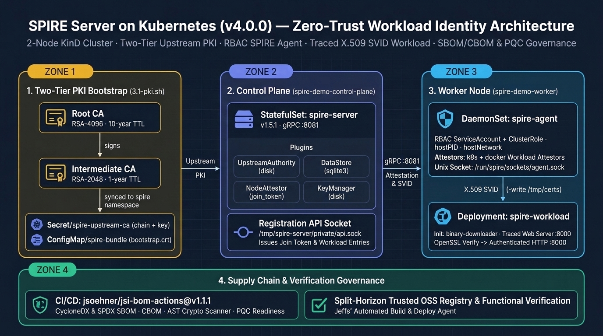
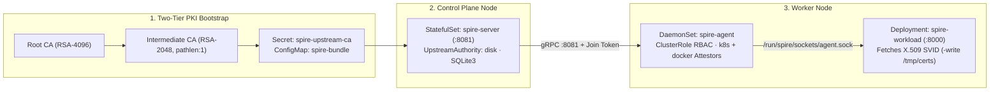

# SPIRE Server on Kubernetes (`spire-server-k8s`) — `v4.0.0`

Self-extracting Kubernetes (KinD) orchestrators for deploying **SPIFFE / SPIRE** zero-trust workload identity across a 2-node cluster (Control Plane + Worker) with a two-tier OpenSSL UpstreamAuthority PKI, RBAC-enabled SPIRE Agent DaemonSet, traced X.509 SVID web workload, and automated SBOM/CBOM/PQC supply chain governance.

> **Latest Verification (`2026-11-20` · `v4.0.0`):** Verified end-to-end (shell/Python syntax, isolated generator extraction, trust-domain substitution, 22/22 Kubernetes & workflow YAML manifests, OpenSSL Root -> Intermediate PKI chain, and CBOM AST scan) by **Jeffs' Automated build and deploy agent** — see [`docs/BUILD_VERIFICATION.md`](docs/BUILD_VERIFICATION.md).



---

## Quick Start

### Prerequisites
- [KinD](https://kind.sigs.k8s.io/) (`kind`)
- `kubectl`
- `openssl` & `python3`
- Docker (or compatible container runtime)

### Run the `v4.0.0` 2-Node + Traced Workload Demo (Recommended)

```bash
git clone https://github.com/jsoehner/spire-server-k8s.git
cd spire-server-k8s
./setup_demo-2node-web.sh --trusted_domain scotiabank.local --reset
```

| Flag | Description |
| :--- | :--- |
| `--trusted_domain <domain>` | Custom SPIFFE trust domain (default: `example.org`). Automatically substituted across server, agent, and workload manifests. |
| `--reset` | Tears down any existing `spire-demo` KinD cluster and clears local `./pki` artifacts before provisioning. |
| `--newroot` | Forces regeneration of the Root CA and Intermediate CA certificates (`3.1-pki.sh --force`). |

### Available Demo Generators

| Script | Version | Topology & Capabilities |
| :--- | :--- | :--- |
| [`setup_demo-2node-web.sh`](setup_demo-2node-web.sh) | **`v4.0.0`** | **Recommended.** 2-node KinD cluster, two-tier OpenSSL PKI, control-plane `spire-server`, RBAC-enabled `spire-agent` DaemonSet, and traced `spire-workload` HTTP server (`:8000`) fetching X.509 SVIDs via `-write /tmp/certs`. |
| [`setup_demo-2node.sh`](setup_demo-2node.sh) | `v3.2` | 2-node KinD cluster (`control-plane` + `worker`) with custom `--trusted_domain` support. |
| [`setup_demo-v3.0.sh`](setup_demo-v3.0.sh) | `v3.0` | Minimal 1-node KinD baseline (`example.org`). |

---

## Architecture & Logical Flow



For full C4-style component details, sequence diagrams, and topology comparisons, see [`docs/architecture.md`](docs/architecture.md) and [`CHANGELOG.md`](CHANGELOG.md).

<details>
<summary>Sample Traced Execution Output (<code>./setup_demo-2node-web.sh --trusted_domain scotiabank.local --reset</code>)</summary>

```text
📂 Creating project directory: spire_k8s_demo_v4.0...
🔧 Configuration:
   - Trust Domain: scotiabank.local
   - Architecture: 2-Node (Control Plane + Worker)
   - Version:      v4.0.0 (2-Node RBAC + Traced Workload)
   - Capability:   Deep Tracing Enabled
📦 Creating 2-Node Kubernetes Cluster (Kind)...
🔐 Initializing PKI...
   [PKI] Generating Root CA...
   [PKI] Generating Intermediate CA...
   [PKI] Syncing PKI to Kubernetes...
☁️  Deploying SPIRE Server...
🤝 Registering Agent (RBAC Enabled)...
   ✅ Server is healthy.
   ✅ Agent Registered and Running.
🌐 Deploying Traced Workload...
   ✅ Registered: spiffe://scotiabank.local/workload/web-server
   ✅ Workload Deployed.
🎉 Demo Environment Ready!
[TRACE] 12:31:19 | 🚀 Workload Started. Initializing Identity Loop...
[TRACE] 12:31:19 | 🔌 Connecting to SPIRE Agent Socket: /run/spire/sockets/agent.sock
[TRACE] 12:31:19 | ✅ RESPONSE RECEIVED: Identity fetched.
[TRACE] 12:31:19 | 📄 Reading SVID from: /tmp/certs/svid.0.pem
subject=C=US, O=SPIRE, x500UniqueIdentifier=24d6d4051a9a9ae5214b7c440172ca66
issuer=C=US, O=SPIRE Demo
X509v3 Subject Alternative Name:
    URI:spiffe://scotiabank.local/workload/web-server
[TRACE] 12:31:19 | 🌍 Starting Web Server on Port 8000...
```

</details>

---

## 🔐 SBOM, CBOM & PQC Governance

This repository integrates the [`jsoehner/jsi-bom-actions`](https://github.com/jsoehner/jsi-bom-actions) GitHub Action ([`.github/workflows/sbom-cbom.yml`](.github/workflows/sbom-cbom.yml)) for automated Software Bill of Materials (SBOM), Cryptographic Bill of Materials (CBOM), and Post-Quantum Cryptography (PQC) readiness auditing.

- **Latest Audit Report:** [`docs/security/CRYPTOGRAPHIC_AUDIT.md`](docs/security/CRYPTOGRAPHIC_AUDIT.md)
- **Learn More:** [jsoehner/jsi-bom-actions](https://github.com/jsoehner/jsi-bom-actions)

---

## Architectural Decision Records (ADRs)

Key architectural decisions governing this repository's Kubernetes topology, zero-trust PKI, supply chain, and cryptography strategy are documented under [`docs/adr/`](docs/adr/README.md):

- [**ADR-0001: Automated SBOM and CBOM Supply Chain Governance**](docs/adr/0001-automated-sbom-cbom-supply-chain-governance.md) *(Partially Superseded by ADR-0003)*
- [**ADR-0002: Multi-Node KinD SPIRE Architecture, RBAC Agent Attestation, and Traced SVID Workload**](docs/adr/0002-multi-node-kind-spire-architecture-and-traced-workload.md) *(Accepted)*
- [**ADR-0003: Unified `jsi-bom-actions` Composite Governance & Trusted OSS Split-Horizon Registry**](docs/adr/0003-unified-jsi-bom-actions-and-trusted-oss-governance.md) *(Accepted)*

---

## ✅ Build & Functional Verification

- **Version:** [`4.0.0`](VERSION) ([`CHANGELOG.md`](CHANGELOG.md))
- **Last Verified:** `2026-11-20` by **Jeffs' Automated build and deploy agent**
- **Report:** [`docs/BUILD_VERIFICATION.md`](docs/BUILD_VERIFICATION.md)
