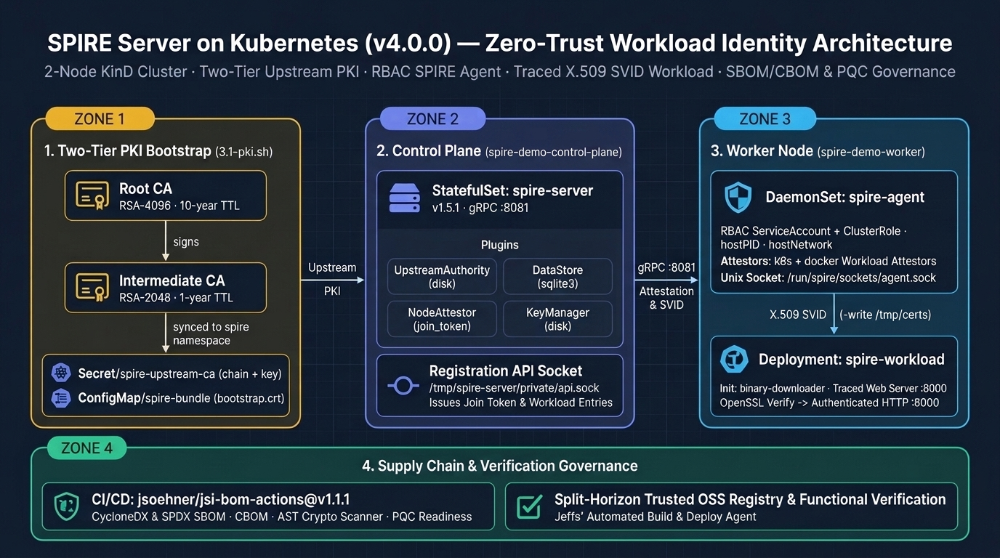
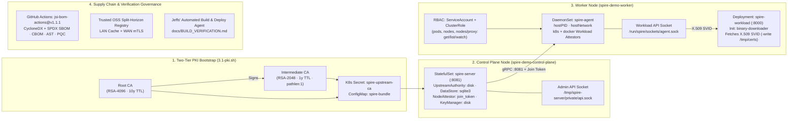
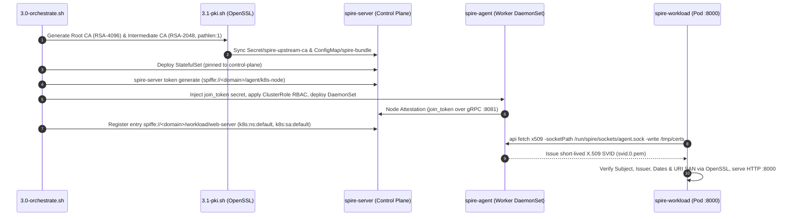

# Architecture Overview (`v4.0.0`)

`spire-server-k8s` provides self-extracting, reproducible Bash/Python orchestrators for deploying **SPIFFE / SPIRE** zero-trust workload identity on **Kubernetes (KinD)** with a two-tier upstream OpenSSL PKI, RBAC-enabled SPIRE Agent DaemonSets, traced X.509 SVID workloads, and automated SBOM/CBOM/PQC supply chain governance.

---

## 1. System Context & Logical Flow

---

## 2. X.509 SVID Issuance & Verification Sequence

---

## 3. Generator Evolution & Topology Comparison

| Generator Script | Version | KinD Topology | Agent RBAC | Custom Trust Domain | Traced Web Workload |
| :--- | :--- | :--- | :--- | :--- | :--- |
| `setup_demo-v3.0.sh` | `v3.0` | 1-Node (`control-plane`) | — | Fixed (`example.org`) | No |
| `setup_demo-2node.sh` | `v3.2` | 2-Node (`control-plane` + `worker`) | — | `--trusted_domain` | No |
| `setup_demo-2node-web.sh` | **`v4.0.0`** | 2-Node (`control-plane` + `worker`) | `ServiceAccount` + `ClusterRole` + `ClusterRoleBinding` | `--trusted_domain` | Yes (`3.4-deploy-workload.py`, `-write` SVID trace + HTTP `:8000`) |

---

## 4. Supply Chain, Cryptographic & PQC Governance

- **CI/CD Workflow (`.github/workflows/sbom-cbom.yml`):** Uses SHA-pinned [`jsoehner/jsi-bom-actions`](https://github.com/jsoehner/jsi-bom-actions) (`v1.1.1`) to generate CycloneDX/SPDX SBOMs, CycloneDX CBOMs, AST cryptographic call-site inventories, and PQC readiness reports.
- **Automated Audit Report:** Published to [`docs/security/CRYPTOGRAPHIC_AUDIT.md`](security/CRYPTOGRAPHIC_AUDIT.md). Currently tracks classical RSA-4096/RSA-2048 OpenSSL CA generation in the demo PKI scripts with NIST FIPS 203/204 PQC migration guidance.
- **Local Tooling (`scripts/`):** `generate_boms.sh`, `test_boms.sh`, `scan_crypto_ast.py`, `analyze_cbom.py`, `attach_oci_bom.sh`, and `fetch_oci_cbom.py` support local offline auditing.
- **Trusted OSS Split-Horizon & Functional Verification:** Configured for local LAN caching and WAN mTLS CI, with verification evidence recorded in [`docs/BUILD_VERIFICATION.md`](BUILD_VERIFICATION.md).

---

## 5. Architectural Decision Records (ADRs)

See the full index at [`docs/adr/README.md`](adr/README.md):

- [**ADR-0001: Automated SBOM and CBOM Supply Chain Governance**](adr/0001-automated-sbom-cbom-supply-chain-governance.md) *(Partially Superseded by ADR-0003)*
- [**ADR-0002: Multi-Node KinD SPIRE Architecture, RBAC Agent Attestation, and Traced SVID Workload**](adr/0002-multi-node-kind-spire-architecture-and-traced-workload.md) *(Accepted)*
- [**ADR-0003: Unified `jsi-bom-actions` Composite Governance & Trusted OSS Split-Horizon Registry**](adr/0003-unified-jsi-bom-actions-and-trusted-oss-governance.md) *(Accepted)*
